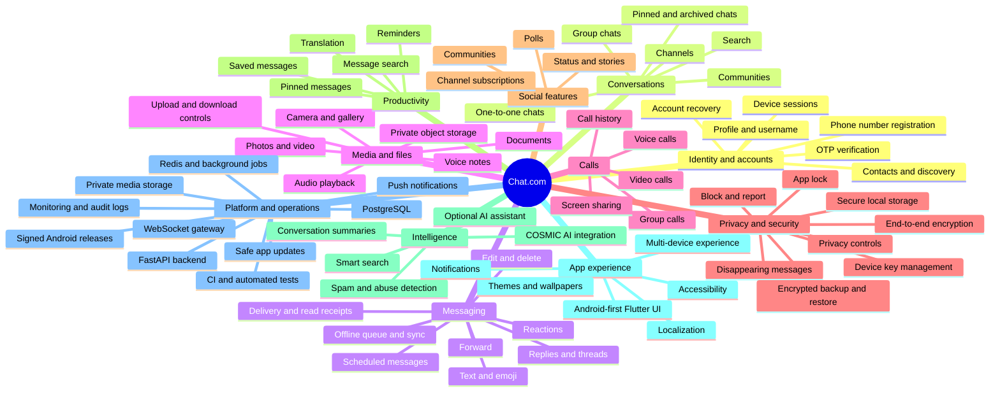

# Chat.com — Complete Product Mind Map

Chat.com is an Android-first, privacy-focused communication app. The product is independent from COSMIC AI; optional integration may be added later through a secure, user-authorized API.

## Product rules

- Phone number plus OTP is the intended sign-in experience. Real SMS verification must use a configured provider; development test codes must never be presented as production verification.
- A message is not considered delivered merely because the sender tapped Send. Delivery states must reflect server/device acknowledgements.
- Private conversations and media must be protected by authorization checks. Public media URLs are not acceptable.
- End-to-end encryption must use a reviewed protocol and maintained implementation. No custom cryptography.
- AI and COSMIC integration are optional and must not weaken the messaging privacy boundary.
- The app must remain useful and responsive on Android phones, including smaller screens.
- Features must be visibly labeled as unavailable until they genuinely work.
